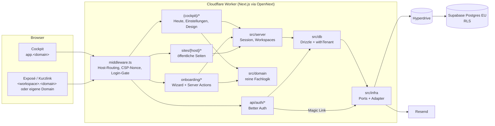

# Architektur

Stand: Phase 0. Verbindlich ist [ZIELPROMPT.md](../ZIELPROMPT.md); dieses Dokument beschreibt, wie es
umgesetzt ist.

## Komponenten



## Schichten

| Ordner           | Inhalt                                                                              | Regeln                                      |
| ---------------- | ----------------------------------------------------------------------------------- | ------------------------------------------- |
| `src/app`        | Routen, Server Components, Server Actions                                           | dünn; ruft `src/server` und `src/domain`    |
| `src/domain`     | reine Fachlogik: `can()`, `entitlements()`, Slugs, Host-Klassifikation, Zod-Schemas | keine I/O, voll unit-getestet               |
| `src/server`     | serverseitige Dienste: Auth, Session, Workspaces                                    | `server-only`                               |
| `src/db`         | Drizzle-Schema, Client, `withTenant()`                                              | Standard-Postgres                           |
| `src/infra`      | Ports (`types.ts`) und Adapter je Anbieter                                          | einziger Ort für Anbieter-SDKs (Lint-Regel) |
| `src/components` | UI-Bausteine auf Radix + Tailwind                                                   | Tokens aus `src/design/tokens.ts`           |

## Anfrage-Fluss

1. **Middleware** klassifiziert den `Host`:
   - `APP_URL`-Host → Cockpit. Ohne Session-Cookie Umleitung auf `/login` (echte Prüfung im Layout).
   - `<slug>.<PLATFORM_DOMAIN>` oder eigene Domain → Rewrite auf `/sites/<host>/…`.
   - alles andere → 404.
     Dazu: CSP mit Nonce pro Anfrage, `X-Robots-Tag: noindex, nofollow`.
2. **Cockpit-Layout** ruft `requireCockpit()`: gültige Session, Mitgliedschaft, Onboarding abgeschlossen,
   sonst `/login` bzw. `/onboarding`.
3. **Datenzugriff** für Workspace-Daten nur über `withTenant()`.

## Kurzlinks und Tracking (Phase 2)

1. **Scan**: `<host>/<code>` → `sites/[host]/[code]/route.ts` sucht den Touchpoint (QR-Token exakt,
   Kurzcode normalisiert), legt einen Visit an (Bot-/Owner-Flag, Gerät, Stadt, keine IP) und leitet mit
   signiertem Ticket auf `/x/<slug>?v=…` weiter. Unbekannte Codes → `/nicht-gefunden`.
2. **Exposé**: `ExposeTracker` (nur öffentlich) schickt das Ticket an `/t/start` und erhält einen
   Visit-Token (nur im Speicher). Der erste echte Besuch setzt den Status auf „Geöffnet“.
3. **Events**: gebündelt an `/t/e` (Zod-Validierung, Rate Limit), Aggregate direkt am Visit.
4. **Cockpit**: `/kunden` (Liste, Ansichten, CSV), `/kunden/pipeline`, `/kunden/[id]` (Timeline aus
   Visits, Events und Audit-Log; QR-Export als SVG/PNG).

Die öffentlichen Routen laufen auf der System-Verbindung, jede Abfrage ist auf den Workspace des Hosts
eingeschränkt. Mitglieder lesen Visits und Events nur (RLS, `GRANT SELECT`).

## Mandantentrennung (§9a)

```
Login-Rolle (Owner der Tabellen) ──► Auth, Workspace-Anlage, Host-Auflösung, Jobs
        │
        └─ SET LOCAL ROLE aquisiteur_app
           set_config('app.user_id', …), set_config('app.workspace_id', …)
           ──► RLS-Policies: workspace_id = app.current_workspace_id()
                             AND app.is_member(workspace_id)
```

- Jede Tabelle mit Fachdaten hat `workspace_id NOT NULL` und eine Policy; ein DB-Test prüft das für alle
  Tabellen automatisch (`tests/db/tenant-isolation.test.ts`).
- `app.is_member()` und `app.has_role()` sind `SECURITY DEFINER`, damit Policies auf `memberships` nicht
  rekursiv werden.
- Auth-Tabellen (`sessions`, `accounts`, `verifications`, `passkeys`, `rate_limits`) und
  `platform_admins` sind für die Tenant-Rolle komplett gesperrt.
- `audit_log` und `usage_events` sind für die Tenant-Rolle nur anfügbar (kein UPDATE/DELETE).
- Berechtigungen im Code laufen über `can(actor, action, resource)` (`src/domain/authz.ts`).

## Datenmodell (Phase 0)

| Tabelle                                                                     | Zweck                                                                          |
| --------------------------------------------------------------------------- | ------------------------------------------------------------------------------ |
| `users`, `sessions`, `accounts`, `verifications`, `passkeys`, `rate_limits` | Better Auth                                                                    |
| `workspaces`                                                                | Mandant; `slug` = Plattform-Subdomain                                          |
| `memberships`                                                               | Nutzer ↔ Workspace mit Rolle `owner`/`admin`/`member`                          |
| `workspace_settings`                                                        | Profil, Kanäle, Absender, Branding, Recht, Aufbewahrung (JSONB, Zod-validiert) |
| `domains`                                                                   | eigene Domains pro Workspace (`pending`/`active`/`failed`)                     |
| `integrations`                                                              | externe Dienste pro Workspace, Secrets AES-256-GCM verschlüsselt               |
| `usage_events`                                                              | abrechnungsrelevante Zähler ab Tag 1                                           |
| `api_tokens`                                                                | Workspace-Tokens für CLI/API (nur Hashes)                                      |
| `audit_log`                                                                 | Audit-Trail pro Workspace                                                      |
| `platform_admins`                                                           | Betreiberrolle, ohne UI                                                        |

Weitere Tabellen (Prospects, Exposés, Touchpoints, Events …) kommen mit ihren Phasen, jeweils mit
`workspace_id`, Policy und Grant in einer Migration.

## Ports in `src/infra`

| Port                     | Phase | Implementierung                        |
| ------------------------ | ----- | -------------------------------------- |
| `DatabasePort`           | 0     | Hyperdrive / `DATABASE_URL`            |
| `EmailPort`              | 0     | Resend, Dev: Log                       |
| `StoragePort`            | 1     | R2 über S3-API                         |
| `RateLimiterPort`        | 2     | Cloudflare Rate Limiting Binding       |
| `CachePort`              | 2     | Workers KV                             |
| `RealtimePort`           | 3     | Supabase Realtime oder Durable Objects |
| `JobQueuePort`           | 4     | Cloudflare Queues + Cron Triggers      |
| `PushPort`               | 4     | Web Push (VAPID)                       |
| `LetterDispatchProvider` | 5     | `manual`, danach Pingen                |
| `DomainPort`             | 1/6   | Cloudflare for SaaS (Custom Hostnames) |
