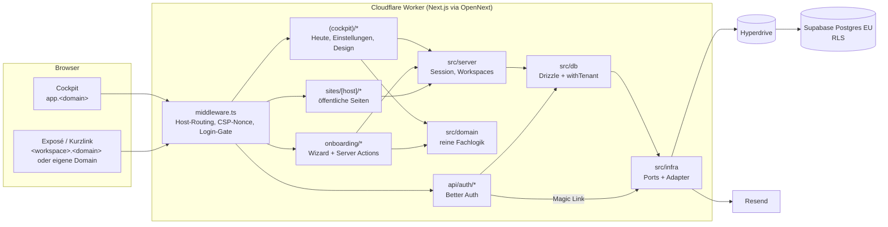

# Architektur

Stand: Phase 0. Verbindlich ist [ZIELPROMPT.md](../ZIELPROMPT.md); dieses Dokument beschreibt, wie es
umgesetzt ist.

## Komponenten



## Schichten

| Ordner           | Inhalt                                                                              | Regeln                                      |
| ---------------- | ----------------------------------------------------------------------------------- | ------------------------------------------- |
| `src/app`        | Routen, Server Components, Server Actions                                           | dünn; ruft `src/server` und `src/domain`    |
| `src/domain`     | reine Fachlogik: `can()`, `entitlements()`, Slugs, Host-Klassifikation, Zod-Schemas | keine I/O, voll unit-getestet               |
| `src/server`     | serverseitige Dienste: Auth, Session, Workspaces                                    | `server-only`                               |
| `src/db`         | Drizzle-Schema, Client, `withTenant()`                                              | Standard-Postgres                           |
| `src/infra`      | Ports (`types.ts`) und Adapter je Anbieter                                          | einziger Ort für Anbieter-SDKs (Lint-Regel) |
| `src/components` | UI-Bausteine auf Radix + Tailwind                                                   | Tokens aus `src/design/tokens.ts`           |

## Anfrage-Fluss

1. **Middleware** klassifiziert den `Host`:
   - `APP_URL`-Host → Cockpit. Ohne Session-Cookie Umleitung auf `/login` (echte Prüfung im Layout).
   - `<slug>.<PLATFORM_DOMAIN>` oder eigene Domain → Rewrite auf `/sites/<host>/…`.
   - alles andere → 404.
     Dazu: CSP mit Nonce pro Anfrage, `X-Robots-Tag: noindex, nofollow`.
2. **Cockpit-Layout** ruft `requireCockpit()`: gültige Session, Mitgliedschaft, Onboarding abgeschlossen,
   sonst `/login` bzw. `/onboarding`.
3. **Datenzugriff** für Workspace-Daten nur über `withTenant()`.

## Kurzlinks und Tracking (Phase 2)

1. **Scan**: `<host>/<code>` → `sites/[host]/[code]/route.ts` sucht den Touchpoint (QR-Token exakt,
   Kurzcode normalisiert), legt einen Visit an (Bot-/Owner-Flag, Gerät, Stadt, keine IP) und leitet mit
   signiertem Ticket auf `/x/<slug>?v=…` weiter. Unbekannte Codes → `/nicht-gefunden`.
2. **Exposé**: `ExposeTracker` (nur öffentlich) schickt das Ticket an `/t/start` und erhält einen
   Visit-Token (nur im Speicher). Der erste echte Besuch setzt den Status auf „Geöffnet“.
3. **Events**: gebündelt an `/t/e` (Zod-Validierung, Rate Limit), Aggregate direkt am Visit.
4. **Cockpit**: `/kunden` (Liste, Ansichten, CSV), `/kunden/pipeline`, `/kunden/[id]` (Timeline aus
   Visits, Events und Audit-Log; QR-Export als SVG/PNG).

Die öffentlichen Routen laufen auf der System-Verbindung, jede Abfrage ist auf den Workspace des Hosts
eingeschränkt. Mitglieder lesen Visits und Events nur (RLS, `GRANT SELECT`).

## Kontakt und Chat (Phase 3)

1. **Besucher**: `ContactLayer` (nur öffentlich) zeigt Launcher, höchstens einen Nudge pro Seitenaufruf
   (`pickNudge`) und auf dem Handy die Kontaktleiste. Das Chat-Panel lädt erst bei Bedarf.
2. **Schreiben** immer über die App: `/t/chat`, `/t/chat/typing`, `/t/chat/read`, `/t/chat/contact`,
   `/t/chat/offline`, `/t/callback` (System-Verbindung, auf den Workspace des Hosts beschränkt).
   Cockpit-Antworten sind Server Actions über `withTenant` (`chat.reply`).
3. **Zustellen**: nach dem Commit `publish()` an `ws-<workspace>` und `chat-<thread>` über
   `RealtimePort` (ADR-0020). Lokal SSE (`/api/live`, `/t/live`), in Produktion Supabase Broadcast.
   Ereignisse sind nur Hinweise; Clients laden den Stand danach von der App.
4. **Cockpit**: `LiveProvider` hält eine Verbindung pro Tab und schickt den Präsenz-Heartbeat.

## Kontaktabsicht und Benachrichtigungen (Phase 4)

1. **Signal**: Besuch, Events, Entwurf, Nachricht, Rückruf oder Opt-out landen wie bisher über die
   öffentlichen Routen. Danach plant `defer()` (`after()`) die Auswertung, die Antwort wartet nicht.
2. **Score**: `processProspect` lädt die Fakten des Kunden (`loadIntentInput`, nur echte Besuche),
   rechnet rein in `src/domain/intent` und speichert `intent_scores` (ADR-0028). Ändert sich der Score,
   geht `intent.updated` an das Cockpit.
3. **Regeln**: `notify()` prüft die Regeln (`src/domain/notifications.ts`), bündelt per `group_key`
   und speichert in `notifications` (`notification.created`). `dispatch()` schickt Push über `PushPort`
   an alle Geräte und E-Mail über `EmailPort` (ADR-0029, ADR-0030).
4. **Zeitgesteuert**: `/api/jobs/hourly` (Cron) verschickt die Tageszusammenfassung (ADR-0032).
5. **Cockpit**: „Heute“ zeigt `listHotProspects` und den Live-Feed (`visit.activity`), die Glocke den
   ungelesenen Zähler, `/benachrichtigungen` die Liste; der Service Worker `/sw.js` zeigt Pushes an.

## Brief und Auswertung (Phase 5)

1. **Kampagnen und Import**: `src/domain/prospects/import.ts` liest und prüft CSV rein,
   `src/server/prospects/import.ts` legt Kunden als Mandant an (ADR-0039).
2. **Briefe**: `src/server/letters/manage.ts` erstellt Entwürfe, setzt sie für das PDF zusammen
   (`composeLetter` in `src/domain/letters/compose.ts`) und führt sie durch den Lebenszyklus über
   `getInfra().letters(provider)` (ADR-0038). Das PDF rendert der Browser (`src/components/letters`,
   ADR-0037).
3. **Auswertung**: `src/server/analytics/*` rechnet in SQL als Mandant (KPIs, Funnel, Aktivität,
   Inhalte, Karte), reine Hilfen in `src/domain/analytics`. Seiten unter `/auswertung` und
   `/kampagnen/[id]` teilen `OverviewSections` und die Filterleiste (ADR-0040).
4. **Karte**: `/api/jobs/hourly` ruft `geocodePending` (System-Verbindung, über `GeocoderPort`) auf;
   Leaflet lädt nur im Browser (ADR-0041).
5. **Replay**: `ReplayConsent` im Exposé → `/t/consent` und `/t/replay` (System-Verbindung, auf den
   Workspace des Hosts begrenzt) → `src/server/tracking/replay.ts` → Storage. Das Cockpit liest als
   Mandant und spielt im Frame ab (ADR-0042).

## Mandantentrennung (§9a)

```
Login-Rolle (Owner der Tabellen) ──► Auth, Workspace-Anlage, Host-Auflösung, Jobs
        │
        └─ SET LOCAL ROLE aquisiteur_app
           set_config('app.user_id', …), set_config('app.workspace_id', …)
           ──► RLS-Policies: workspace_id = app.current_workspace_id()
                             AND app.is_member(workspace_id)
```

- Jede Tabelle mit Fachdaten hat `workspace_id NOT NULL` und eine Policy; ein DB-Test prüft das für alle
  Tabellen automatisch (`tests/db/tenant-isolation.test.ts`).
- `app.is_member()` und `app.has_role()` sind `SECURITY DEFINER`, damit Policies auf `memberships` nicht
  rekursiv werden.
- Auth-Tabellen (`sessions`, `accounts`, `verifications`, `passkeys`, `rate_limits`) und
  `platform_admins` sind für die Tenant-Rolle komplett gesperrt.
- `audit_log` und `usage_events` sind für die Tenant-Rolle nur anfügbar (kein UPDATE/DELETE).
- Berechtigungen im Code laufen über `can(actor, action, resource)` (`src/domain/authz.ts`).

## Datenmodell (Phase 0)

| Tabelle                                                                     | Zweck                                                                          |
| --------------------------------------------------------------------------- | ------------------------------------------------------------------------------ |
| `users`, `sessions`, `accounts`, `verifications`, `passkeys`, `rate_limits` | Better Auth                                                                    |
| `workspaces`                                                                | Mandant; `slug` = Plattform-Subdomain                                          |
| `memberships`                                                               | Nutzer ↔ Workspace mit Rolle `owner`/`admin`/`member`                          |
| `workspace_settings`                                                        | Profil, Kanäle, Absender, Branding, Recht, Aufbewahrung (JSONB, Zod-validiert) |
| `domains`                                                                   | eigene Domains pro Workspace (`pending`/`active`/`failed`)                     |
| `integrations`                                                              | externe Dienste pro Workspace, Secrets AES-256-GCM verschlüsselt               |
| `usage_events`                                                              | abrechnungsrelevante Zähler ab Tag 1                                           |
| `api_tokens`                                                                | Workspace-Tokens für CLI/API (nur Hashes)                                      |
| `audit_log`                                                                 | Audit-Trail pro Workspace                                                      |
| `platform_admins`                                                           | Betreiberrolle, ohne UI                                                        |

Weitere Tabellen (Prospects, Exposés, Touchpoints, Events …) kommen mit ihren Phasen, jeweils mit
`workspace_id`, Policy und Grant in einer Migration.

## Ports in `src/infra`

| Port                     | Phase  | Implementierung                        |
| ------------------------ | ------ | -------------------------------------- |
| `DatabasePort`           | 0      | Hyperdrive / `DATABASE_URL`            |
| `EmailPort`              | 0      | Resend, Dev: Log                       |
| `StoragePort`            | 1      | R2 über S3-API                         |
| `RateLimiterPort`        | 2      | Cloudflare Rate Limiting Binding       |
| `CachePort`              | 2      | Workers KV                             |
| `RealtimePort`           | 3      | Supabase Broadcast, Dev: SSE           |
| `JobQueuePort`           | später | vorerst `after()` + Cron (ADR-0032)    |
| `PushPort`               | 4      | Web Push (VAPID), Dev: Log             |
| `LetterDispatchProvider` | 5      | `manual`, danach Pingen                |
| `GeocoderPort`           | 5      | Nominatim, Tests: Fake                 |
| `DomainPort`             | 1/6    | Cloudflare for SaaS (Custom Hostnames) |
